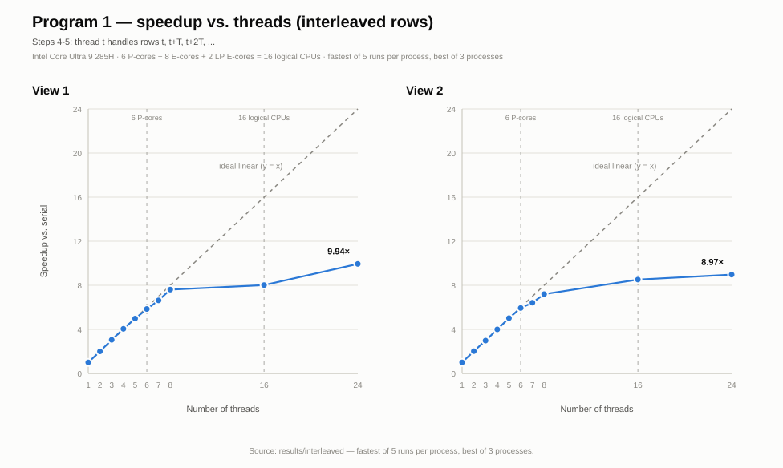
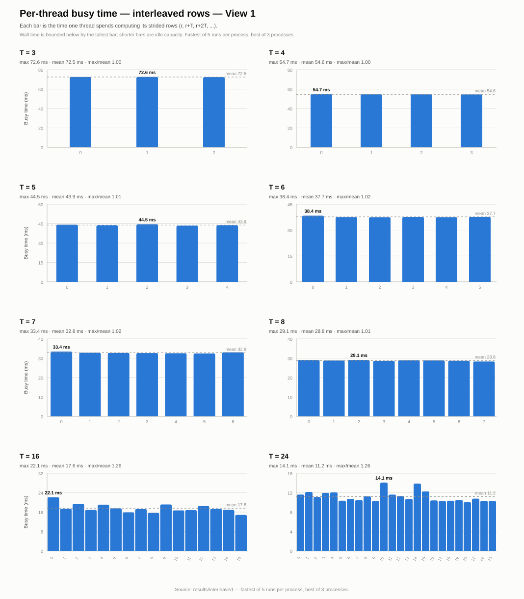
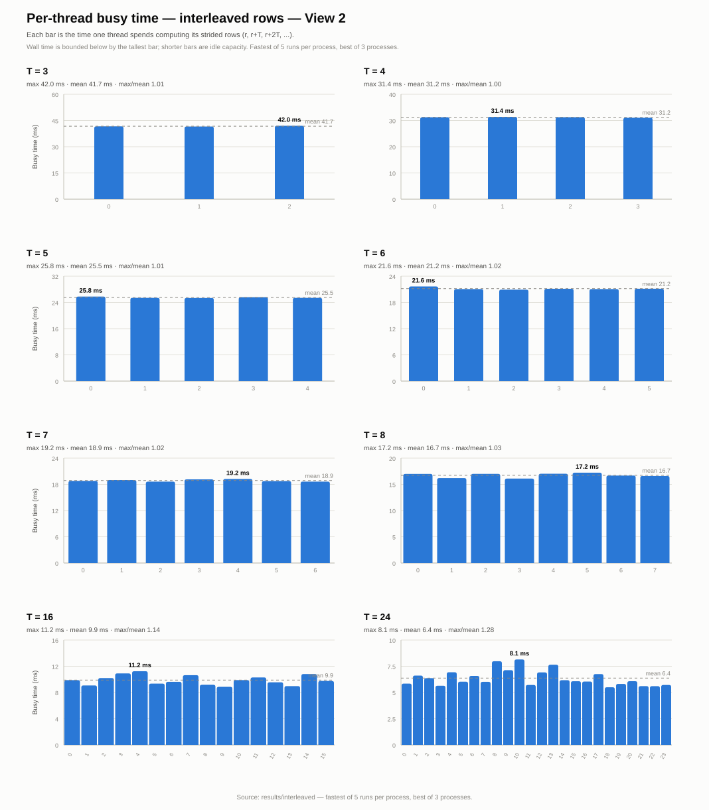
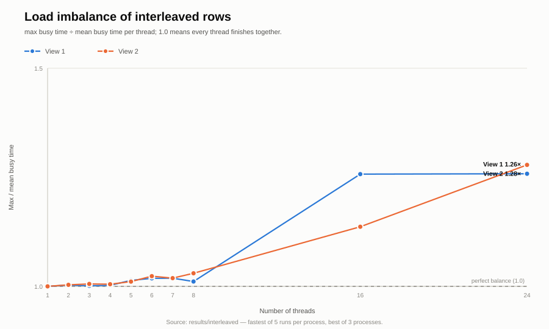

# Program 1, steps 4-5 - interleaved row decomposition

Machine: Intel Core Ultra 9 285H, 16 cores / 16 logical processors (6 P-cores + 8 E-cores + 2 LP E-cores), 63.5 GB RAM.

Build: `g++ -m64 -O3 -std=c++11 -Wall` (MSYS2 UCRT64 g++ 16.2.0).

Decomposition: thread `t` computes rows `t, t+T, t+2T, ...`; every thread gets a mixture of cheap and expensive rows, with no synchronization between threads.

Data: per-run logs were not included in this public snapshot; the aggregated `summary_*.csv`, `thread_busy.csv`, and charts in this directory are derived from them. Each process runs the benchmark 5 times and reports the minimum; the whole process was repeated 3 times. Tables use the fastest process run.

## Speedup and thread balance

### View 1

| Threads | Serial (ms) | Threaded (ms) | Speedup | Max busy (ms) | Mean busy (ms) | Max/Mean |
|---:|---:|---:|---:|---:|---:|---:|
| 1 | 223.393 | 222.557 | 1.00x | 222.549 | 222.549 | 1.00 |
| 2 | 220.858 | 110.614 | 2.00x | 110.344 | 110.022 | 1.00 |
| 3 | 222.138 | 72.757 | 3.05x | 72.561 | 72.465 | 1.00 |
| 4 | 223.000 | 55.014 | 4.05x | 54.734 | 54.608 | 1.00 |
| 5 | 223.077 | 44.834 | 4.98x | 44.511 | 43.910 | 1.01 |
| 6 | 225.556 | 38.563 | 5.85x | 38.393 | 37.699 | 1.02 |
| 7 | 222.818 | 33.588 | 6.63x | 33.413 | 32.798 | 1.02 |
| 8 | 224.082 | 29.455 | 7.61x | 29.113 | 28.794 | 1.01 |
| 16 | 222.117 | 27.700 | 8.02x | 22.123 | 17.596 | 1.26 |
| 24 | 222.346 | 22.362 | 9.94x | 14.097 | 11.205 | 1.26 |

### View 2

| Threads | Serial (ms) | Threaded (ms) | Speedup | Max busy (ms) | Mean busy (ms) | Max/Mean |
|---:|---:|---:|---:|---:|---:|---:|
| 1 | 127.354 | 127.317 | 1.00x | 127.300 | 127.300 | 1.00 |
| 2 | 127.000 | 62.876 | 2.02x | 62.787 | 62.569 | 1.00 |
| 3 | 125.654 | 42.192 | 2.98x | 41.968 | 41.737 | 1.01 |
| 4 | 126.365 | 31.609 | 4.00x | 31.391 | 31.238 | 1.00 |
| 5 | 130.498 | 26.007 | 5.02x | 25.789 | 25.512 | 1.01 |
| 6 | 129.455 | 21.812 | 5.94x | 21.649 | 21.154 | 1.02 |
| 7 | 126.628 | 19.709 | 6.42x | 19.231 | 18.876 | 1.02 |
| 8 | 127.632 | 17.738 | 7.20x | 17.225 | 16.723 | 1.03 |
| 16 | 127.368 | 14.947 | 8.52x | 11.243 | 9.892 | 1.14 |
| 24 | 125.463 | 13.992 | 8.97x | 8.146 | 6.372 | 1.28 |

`Threaded (ms)` is the measured wall time and includes thread creation and join. It is at least `Max busy (ms)`; in this data the gap is 0.0-8.3 ms.

## Per-thread detail: View 1, T = 3

| Thread | Rows | Busy (ms) |
|---:|---:|---:|
| 0 | 400 | 72.474 |
| 1 | 400 | 72.561 |
| 2 | 400 | 72.359 |

Max/mean = 1.00, wall time = 72.757 ms.

## Per-thread detail: View 1, T = 8

| Thread | Rows | Busy (ms) |
|---:|---:|---:|
| 0 | 150 | 29.101 |
| 1 | 150 | 28.792 |
| 2 | 150 | 29.113 |
| 3 | 150 | 28.621 |
| 4 | 150 | 28.930 |
| 5 | 150 | 28.841 |
| 6 | 150 | 28.668 |
| 7 | 150 | 28.285 |

Max/mean = 1.01, wall time = 29.455 ms.

## Per-thread detail: View 2, T = 3

| Thread | Rows | Busy (ms) |
|---:|---:|---:|
| 0 | 400 | 41.666 |
| 1 | 400 | 41.578 |
| 2 | 400 | 41.968 |

Max/mean = 1.01, wall time = 42.192 ms.

## Per-thread detail: View 2, T = 8

| Thread | Rows | Busy (ms) |
|---:|---:|---:|
| 0 | 150 | 16.987 |
| 1 | 150 | 16.193 |
| 2 | 150 | 16.996 |
| 3 | 150 | 16.098 |
| 4 | 150 | 17.018 |
| 5 | 150 | 17.225 |
| 6 | 150 | 16.679 |
| 7 | 150 | 16.590 |

Max/mean = 1.03, wall time = 17.738 ms.

## Figures

### Speedup, both views

### Per-thread busy time, View 1

### Per-thread busy time, View 2

### Load imbalance

All charts are SVG files in `charts/`; individual view speedup charts are `speedup_view1.svg` and `speedup_view2.svg`.
