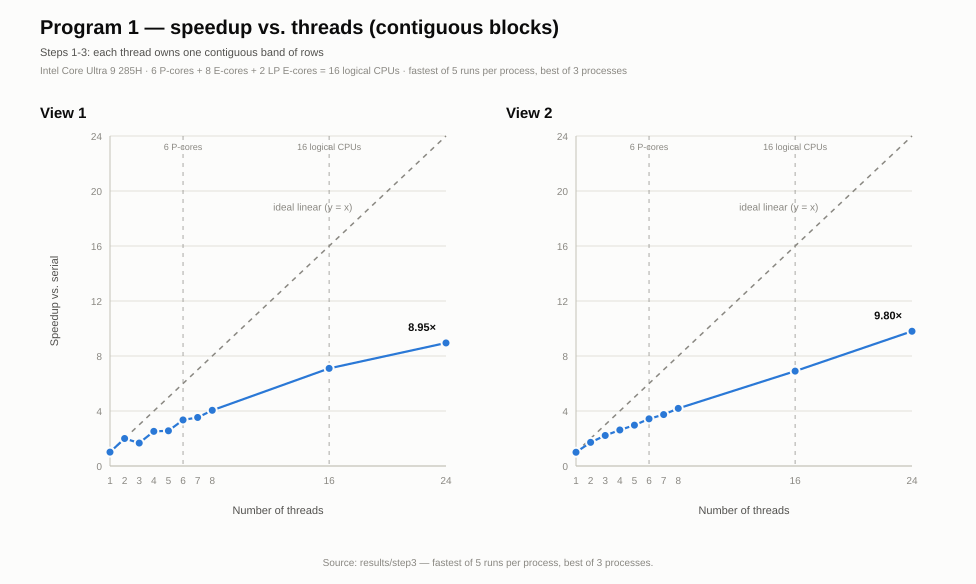
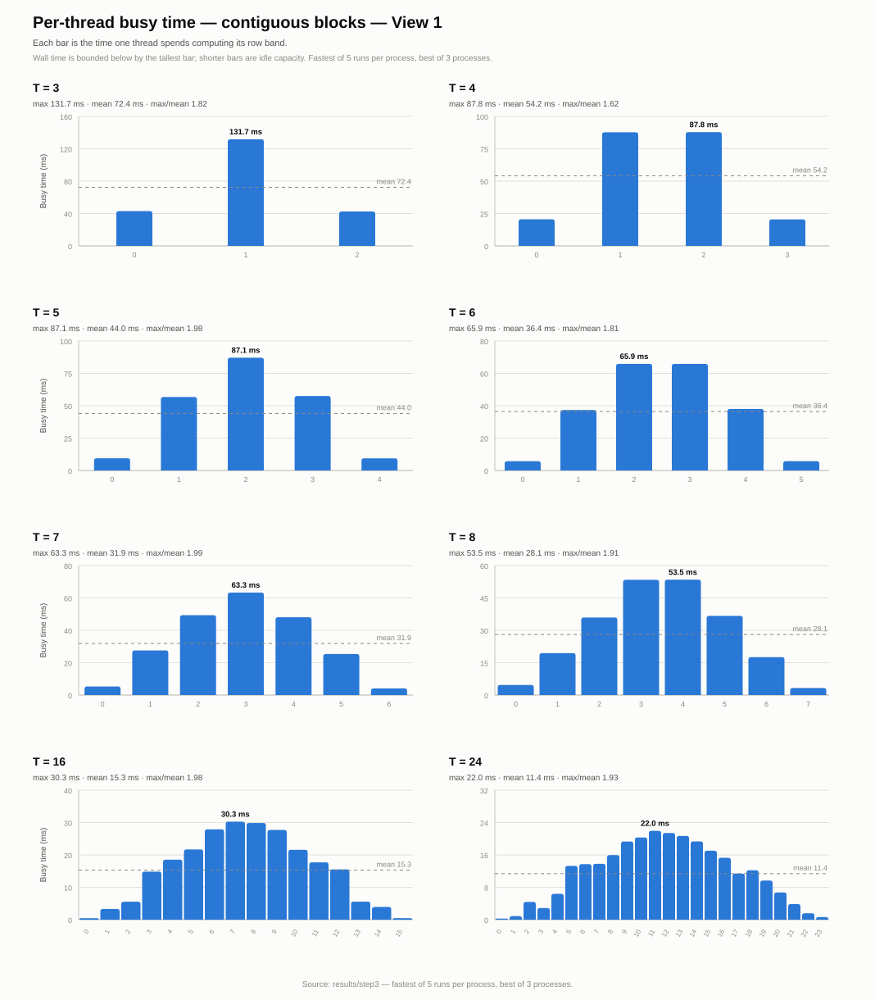
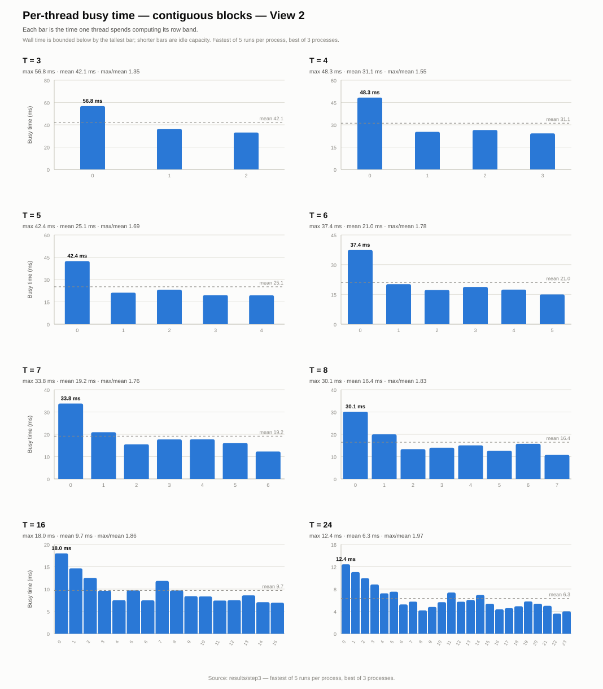
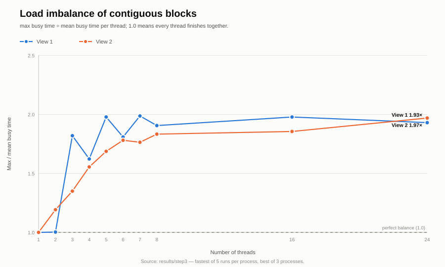

# Program 1, step 3 - contiguous block decomposition

Machine: Intel Core Ultra 9 285H, 16 cores / 16 logical processors (6 P-cores + 8 E-cores + 2 LP E-cores), 63.5 GB RAM.

Build: `g++ -m64 -O3 -std=c++11 -Wall` (MSYS2 UCRT64 g++ 16.2.0).

Data: per-run logs were not included in this public snapshot; the aggregated `summary_*.csv`, `thread_busy.csv`, and charts in this directory are derived from them. Each process runs the benchmark 5 times and reports the minimum; the whole process was repeated 3 times. Tables use the fastest process run.

## Speedup and thread balance

### View 1

| Threads | Serial (ms) | Threaded (ms) | Speedup | Max busy (ms) | Mean busy (ms) | Max/Mean |
|---:|---:|---:|---:|---:|---:|---:|
| 1 | 221.780 | 218.603 | 1.01x | 218.586 | 218.586 | 1.00 |
| 2 | 220.077 | 109.882 | 2.00x | 109.783 | 109.486 | 1.00 |
| 3 | 219.973 | 132.006 | 1.67x | 131.732 | 72.409 | 1.82 |
| 4 | 222.673 | 88.289 | 2.52x | 87.850 | 54.151 | 1.62 |
| 5 | 224.501 | 87.662 | 2.56x | 87.088 | 44.031 | 1.98 |
| 6 | 222.057 | 66.292 | 3.35x | 65.861 | 36.422 | 1.81 |
| 7 | 224.749 | 63.637 | 3.53x | 63.331 | 31.879 | 1.99 |
| 8 | 218.232 | 53.848 | 4.05x | 53.457 | 28.057 | 1.91 |
| 16 | 220.618 | 31.069 | 7.10x | 30.274 | 15.308 | 1.98 |
| 24 | 224.527 | 25.083 | 8.95x | 21.952 | 11.373 | 1.93 |

### View 2

| Threads | Serial (ms) | Threaded (ms) | Speedup | Max busy (ms) | Mean busy (ms) | Max/Mean |
|---:|---:|---:|---:|---:|---:|---:|
| 1 | 126.144 | 125.568 | 1.00x | 125.552 | 125.552 | 1.00 |
| 2 | 126.324 | 73.445 | 1.72x | 73.358 | 61.537 | 1.19 |
| 3 | 126.242 | 56.914 | 2.22x | 56.792 | 42.081 | 1.35 |
| 4 | 126.922 | 48.424 | 2.62x | 48.312 | 31.073 | 1.55 |
| 5 | 126.515 | 42.537 | 2.97x | 42.398 | 25.135 | 1.69 |
| 6 | 128.825 | 37.531 | 3.43x | 37.375 | 20.990 | 1.78 |
| 7 | 127.027 | 33.951 | 3.74x | 33.784 | 19.156 | 1.76 |
| 8 | 127.017 | 30.301 | 4.19x | 30.131 | 16.441 | 1.83 |
| 16 | 126.113 | 18.269 | 6.90x | 17.984 | 9.694 | 1.86 |
| 24 | 127.130 | 12.970 | 9.80x | 12.434 | 6.315 | 1.97 |

`Threaded (ms)` is the measured wall time and includes thread creation and join. It is at least `Max busy (ms)`; in this data the gap is 0.0-3.1 ms.

## Per-thread detail: View 1, T = 3

| Thread | Rows | Busy (ms) |
|---:|---:|---:|
| 0 | 400 | 42.984 |
| 1 | 400 | 131.732 |
| 2 | 400 | 42.512 |

Max/mean = 1.82, wall time = 132.006 ms.

## Per-thread detail: View 2, T = 3

| Thread | Rows | Busy (ms) |
|---:|---:|---:|
| 0 | 400 | 56.792 |
| 1 | 400 | 36.364 |
| 2 | 400 | 33.087 |

Max/mean = 1.35, wall time = 56.914 ms.

## Figures

### Speedup, both views

### Per-thread busy time, View 1

### Per-thread busy time, View 2

### Load imbalance

All charts are SVG files in `charts/`; individual view speedup charts are `speedup_view1.svg` and `speedup_view2.svg`.
